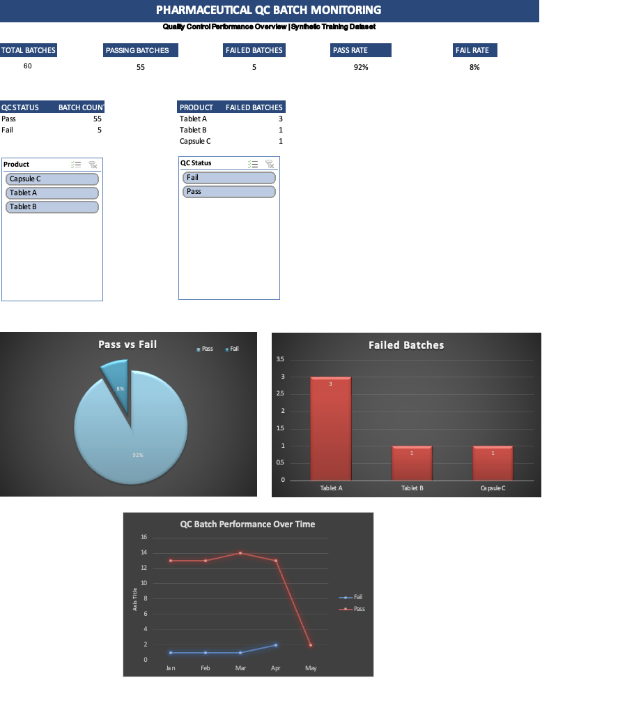

# Pharmaceutical QC Batch Monitoring Dashboard

## Project Overview

An Excel-based pharmaceutical quality control (QC) analysis project using a synthetic dataset of 60 batch testing records.

The project focuses on evaluating batch quality, identifying out-of-specification (OOS) results, and presenting QC performance through an interactive dashboard.

## Objectives

- Evaluate test results against predefined specification limits.
- Identify passing and failing QC records.
- Calculate overall batch pass and failure rates.
- Analyse product-wise failures and monthly testing trends.
- Develop an interactive Excel dashboard for QC performance monitoring.

## Tools Used

- Microsoft Excel 365
- Excel Tables and structured references
- IF, COUNTIF, COUNTIFS, COUNTA and AVERAGEIFS
- Conditional Formatting
- PivotTables and PivotCharts
- Slicers
- Doughnut, column and line charts

## Key Results

| Metric | Result |
|---|---|
| Total QC Records | 60 |
| Passing Records | 55 |
| Failing Records | 5 |
| Pass Rate | 91.67% |
| Failure Rate | 8.33% |

## Product-wise Failures

| Product | Failed Records |
|---|---|
| Tablet A | 3 |
| Tablet B | 1 |
| Capsule C | 1 |

Tablet A accounted for the highest number of failed QC records in this sample. Further investigation would require examining the relevant test parameters, batch histories and potential contributing factors.

## Dashboard Features

- KPI cards displaying overall QC performance
- Pass vs Fail distribution chart
- Product-wise failure comparison
- Monthly QC performance trend
- Interactive slicers for exploring QC results
## Dashboard Preview

## Dataset

The dataset contains 60 fictional pharmaceutical QC testing records, including product names, batch identifiers, test parameters, measured results, specification limits, analysts and QC outcomes.

**Disclaimer:** This project uses synthetic training data and is intended solely for portfolio demonstration. It does not represent real pharmaceutical manufacturing records or a validated GMP quality system.